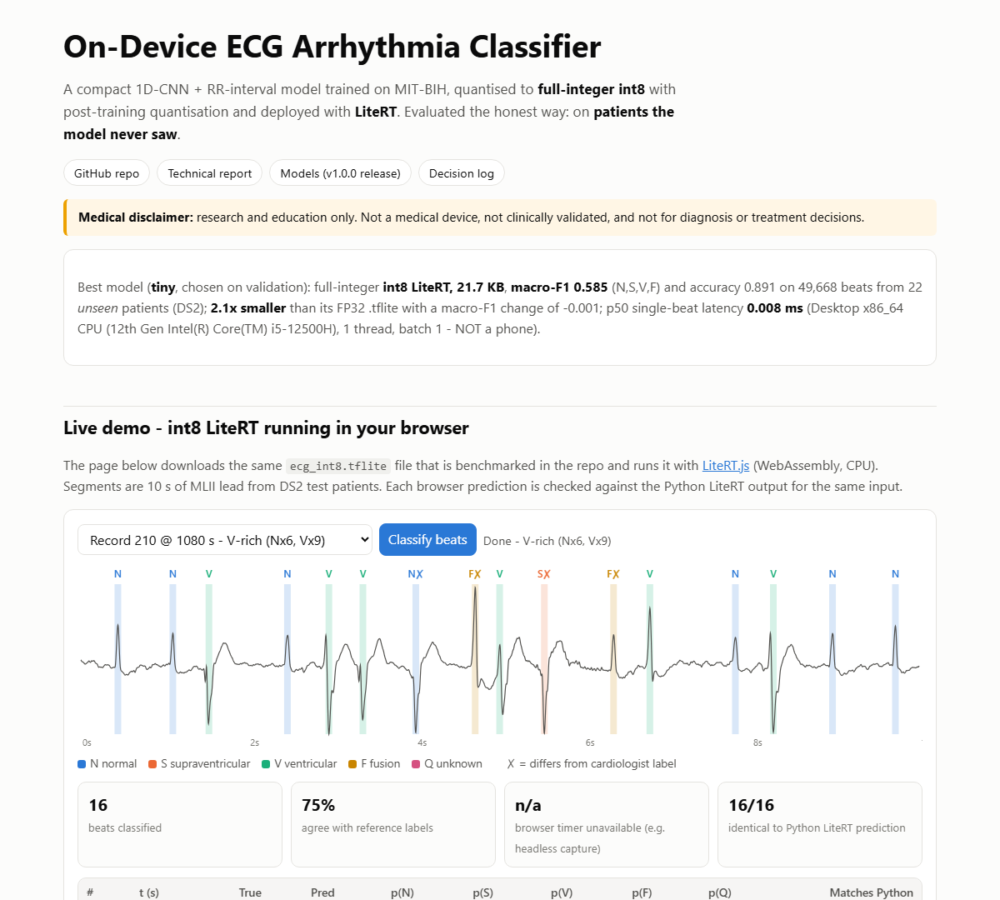
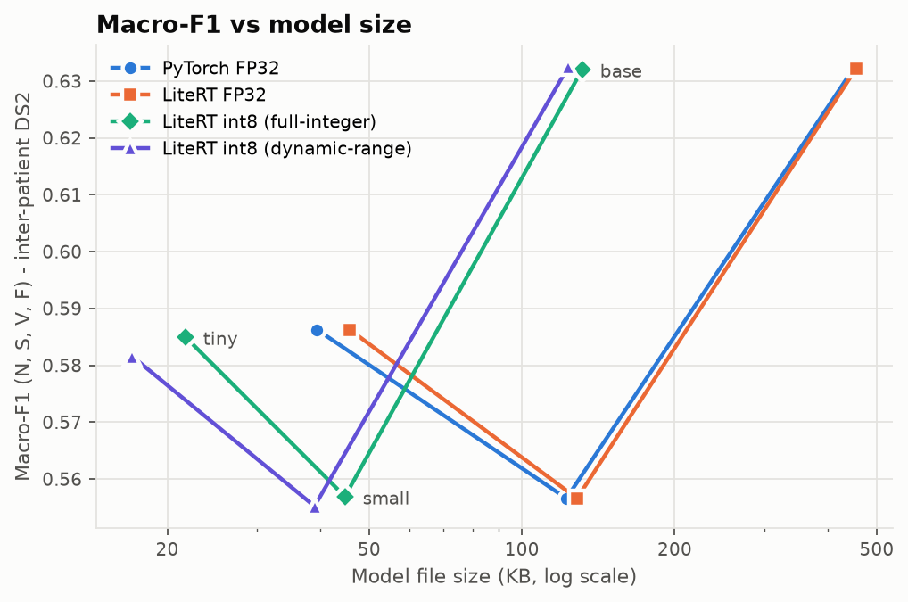
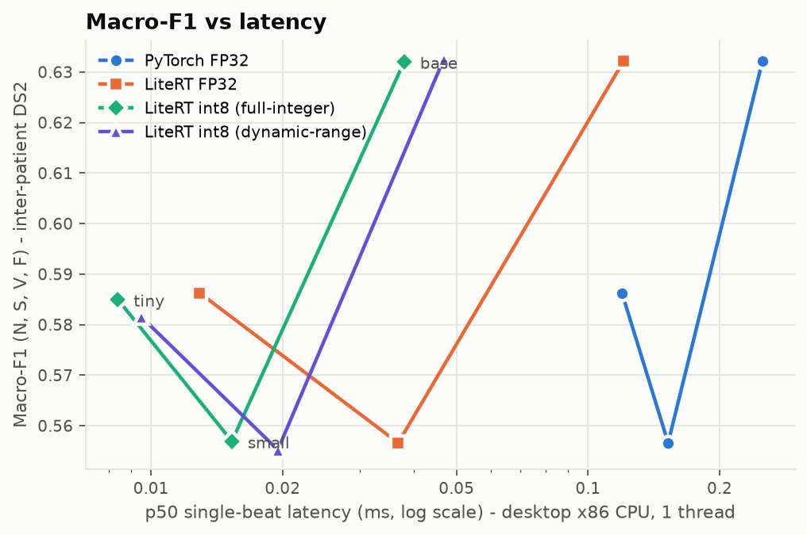
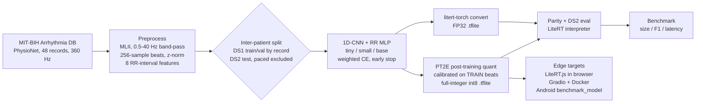
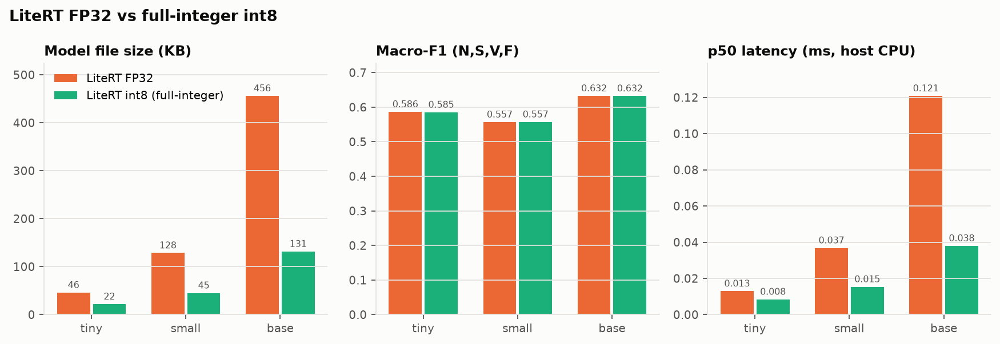
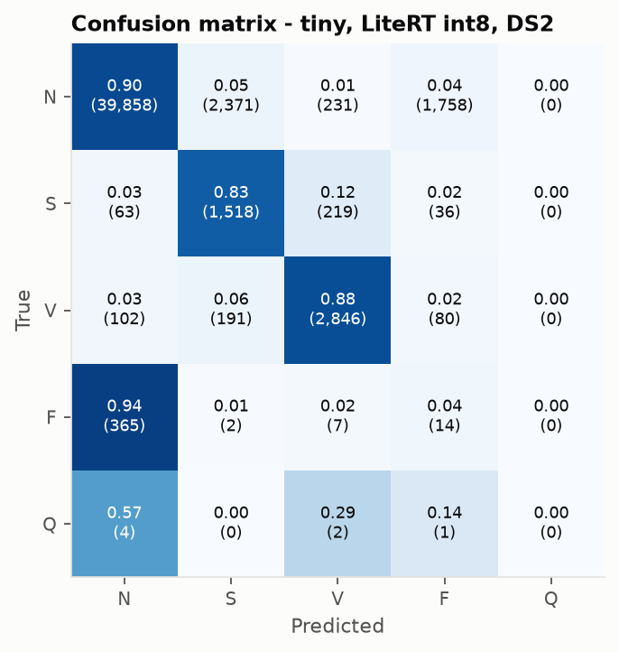
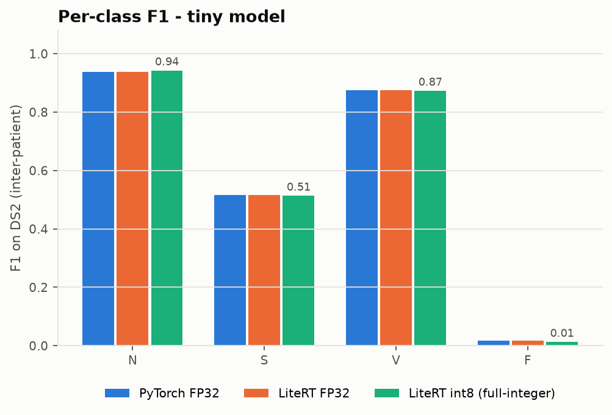

# On-Device ECG Arrhythmia Classifier

[](https://github.com/nikhil3495/ECG-Arrhythmia-Classifier/actions/workflows/ci.yml)
[](LICENSE)
[](https://nikhil3495.github.io/ECG-Arrhythmia-Classifier/)
[](https://github.com/nikhil3495/ECG-Arrhythmia-Classifier/releases/tag/v1.0.0)


**A tens-of-kilobytes, full-integer int8 1D-CNN that classifies heartbeats from patients it has never seen, converted from PyTorch to LiteRT and benchmarked for edge deployment.**

`Python` · `PyTorch` · `LiteRT (litert-torch)` · `int8 post-training quantization` · `MIT-BIH` · `edge ML / TinyML`

<!-- BEGIN:headline -->
Best model (**tiny**, chosen on validation): full-integer **int8 LiteRT, 21.7 KB**, **macro-F1 0.585** (N,S,V,F) and accuracy 0.891 on 49,668 beats from 22 *unseen* patients (DS2); **2.1x smaller** than its FP32 .tflite with a macro-F1 change of -0.0013; p50 single-beat latency **0.008 ms** (Desktop x86_64 CPU (12th Gen Intel(R) Core(TM) i5-12500H), 1 thread, batch 1 - NOT a phone).
<!-- END:headline -->

> [!WARNING]
> **Medical disclaimer.** This is a research and education project. It is **not a medical device**,
> has not been clinically validated, and must not be used to diagnose, treat or monitor anyone.

**Live demo:** <https://nikhil3495.github.io/ECG-Arrhythmia-Classifier/> runs the *same* int8 `.tflite`
in your browser with LiteRT.js (WebAssembly) on 10-second ECG segments from unseen test patients,
and checks every prediction against the Python LiteRT output.

[](https://nikhil3495.github.io/ECG-Arrhythmia-Classifier/)

## Key results (inter-patient, DS2 test set)

Best variant chosen on the **validation** records (the test set was never used for any choice):

<!-- BEGIN:headline_table -->
| Model | Size (KB) | Accuracy | Macro-F1 (N,S,V,F) | F1 N | F1 S | F1 V | F1 F | p50 latency (ms) |
|---|---:|---:|---:|---:|---:|---:|---:|---:|
| tiny - PyTorch FP32 | 39.4 | 0.882 | 0.586 | 0.937 | 0.517 | 0.875 | 0.017 | 0.120 |
| tiny - LiteRT FP32 | 45.8 | 0.882 | 0.586 | 0.937 | 0.517 | 0.875 | 0.017 | 0.013 |
| tiny - LiteRT int8 (full-integer) | 21.7 | 0.891 | 0.585 | 0.942 | 0.513 | 0.872 | 0.012 | 0.008 |
<!-- END:headline_table -->

Per-class performance of the deployed int8 model (precision = positive predictive value, recall = sensitivity):

<!-- BEGIN:per_class_table -->
| Class | Support | Precision (PPV) | Recall (Se) | F1 |
|---|---:|---:|---:|---:|
| N | 44,218 | 0.987 | 0.901 | 0.942 |
| S | 1,836 | 0.372 | 0.827 | 0.513 |
| V | 3,219 | 0.861 | 0.884 | 0.872 |
| F | 388 | 0.007 | 0.036 | 0.012 |
| Q | 7 | 0.000 | 0.000 | 0.000 |
<!-- END:per_class_table -->

<p align="center"> </p>

<details>
<summary><b>Full benchmark: 3 widths x 4 runtimes</b> (click to expand)</summary>

<!-- BEGIN:hardware -->
Latency measured on **12th Gen Intel(R) Core(TM) i5-12500H** (x86_64, Linux 6.18.33.2-microsoft-standard-WSL2, WSL2), Python 3.12.15, **1 thread, batch 1**, 100 warm-up + 1000 timed runs. This is **desktop x86 CPU latency, not phone latency** - see [`scripts/android_benchmark.md`](scripts/android_benchmark.md) for on-device measurement.
<!-- END:hardware -->

<!-- BEGIN:results_table -->
| Variant | Runtime | Params | Size (KB) | Accuracy | Macro-F1 | F1 N | F1 S | F1 V | F1 F | p50 (ms) | p95 (ms) | Beats/s |
|---|---|---:|---:|---:|---:|---:|---:|---:|---:|---:|---:|---:|
| **tiny** | PyTorch FP32 | 7,285 | 39.4 | 0.882 | 0.586 | 0.937 | 0.517 | 0.875 | 0.017 | 0.120 | 0.166 | 7,917 |
| **tiny** | LiteRT FP32 | 7,285 | 45.8 | 0.882 | 0.586 | 0.937 | 0.517 | 0.875 | 0.017 | 0.013 | 0.014 | 74,816 |
| **tiny** | LiteRT int8 (full-integer) | 7,285 | 21.7 | 0.891 | 0.585 | 0.942 | 0.513 | 0.872 | 0.012 | 0.008 | 0.009 | 116,881 |
| **tiny** | LiteRT int8 (dynamic-range) | 7,285 | 17.1 | 0.879 | 0.582 | 0.935 | 0.503 | 0.872 | 0.016 | 0.009 | 0.013 | 86,777 |
| small | PyTorch FP32 | 28,389 | 122.3 | 0.793 | 0.557 | 0.879 | 0.447 | 0.887 | 0.012 | 0.152 | 0.210 | 6,284 |
| small | LiteRT FP32 | 28,389 | 128.4 | 0.793 | 0.557 | 0.879 | 0.447 | 0.887 | 0.012 | 0.037 | 0.045 | 26,553 |
| small | LiteRT int8 (full-integer) | 28,389 | 44.8 | 0.798 | 0.557 | 0.883 | 0.444 | 0.891 | 0.010 | 0.015 | 0.020 | 59,944 |
| small | LiteRT int8 (dynamic-range) | 28,389 | 39.0 | 0.792 | 0.555 | 0.879 | 0.442 | 0.888 | 0.012 | 0.020 | 0.021 | 51,102 |
| base | PyTorch FP32 | 112,069 | 450.3 | 0.933 | 0.632 | 0.969 | 0.642 | 0.874 | 0.044 | 0.251 | 0.312 | 3,851 |
| base | LiteRT FP32 | 112,069 | 455.7 | 0.933 | 0.632 | 0.969 | 0.642 | 0.874 | 0.044 | 0.121 | 0.143 | 8,038 |
| base | LiteRT int8 (full-integer) | 112,069 | 131.4 | 0.928 | 0.632 | 0.966 | 0.647 | 0.873 | 0.043 | 0.038 | 0.049 | 24,886 |
| base | LiteRT int8 (dynamic-range) | 112,069 | 123.4 | 0.932 | 0.633 | 0.968 | 0.644 | 0.875 | 0.044 | 0.047 | 0.058 | 21,218 |
<!-- END:results_table -->

Source: [`results/benchmark.json`](results/benchmark.json) (+ [`results/export.json`](results/export.json) for parity checks).
</details>

## Pipeline



**Model.** Four `Conv1d -> BatchNorm -> ReLU -> MaxPool` blocks, global average pooling, concatenated
with a small MLP over 8 RR-interval features (pre/post RR, local and 5-min average RR, and their
ratios), then a two-layer head with 5 AAMI outputs (N, S, V, F, Q). Every op lowers to an int8
LiteRT builtin; RR standardisation is baked into the graph so the deployed model takes raw features.

## Why inter-patient evaluation

Most public MIT-BIH notebooks shuffle all beats and split them at random, reporting ~99% accuracy.
Because consecutive beats of the same patient end up in both train and test, the network can
memorise each patient's waveform, so the score says little about a **new** wearer. This project uses the
standard inter-patient protocol of de Chazal et al. (2004): train on the 22 DS1 records, test on
the 22 disjoint DS2 records, excluding paced records 102/104/107/217 (AAMI EC57). Validation
records are also held out by patient. The leaky random split is reported only for comparison:

<!-- BEGIN:protocol_table -->
| Protocol (same architecture, PyTorch FP32) | Test beats | Accuracy | Macro-F1 (N,S,V,F) | F1 N | F1 S | F1 V | F1 F |
|---|---:|---:|---:|---:|---:|---:|---:|
| **Inter-patient** (DS1 -> DS2, unseen patients) | 49,668 | 0.882 | 0.586 | 0.937 | 0.517 | 0.875 | 0.017 |
| Intra-patient random 80/20 split (leaky, optimistic) | 20,129 | 0.979 | 0.863 | 0.989 | 0.842 | 0.963 | 0.656 |
<!-- END:protocol_table -->

<!-- BEGIN:protocol_text -->
The identical architecture scores macro-F1 **0.863** on a random beat-level split but **0.586** on unseen patients - a gap of 0.276. The random split lets the network memorise each patient's beat morphology, because neighbouring beats of the same person sit in both train and test.
<!-- END:protocol_text -->

Because classes are heavily imbalanced (N dominates every split; see [Data](#data)), the headline metric is
**macro-F1 over N, S, V, F**; accuracy alone would reward predicting "normal" for everything. Q is still
predicted, but with paced records removed it has only a handful of beats, so it is left out of the
average as in the literature (5-class macro-F1 is in the JSON files too).

## Quantization findings

<!-- BEGIN:quant_findings -->
- **Size:** int8 files are 2.1-3.5x smaller than FP32 .tflite (tiny: 45.8 KB -> 21.7 KB).
- **Accuracy:** macro-F1 change after int8 PTQ ranges -0.0013 to +0.0003 across variants (tiny: -0.0013).
- **Speed (host CPU):** tiny int8 is 1.54x the speed of LiteRT FP32 and 14.2x the speed of eager PyTorch at batch 1.
- **Parity:** FP32 .tflite predictions agree with PyTorch on 100.00% of DS2 beats (minimum over variants; requirement > 99.9%); full-integer int8 agreement is 98.32%-99.12%.
<!-- END:quant_findings -->

<!-- BEGIN:quant_table -->
| Variant | FP32 -> int8 size | Macro-F1 delta | Accuracy delta | Speed-up vs LiteRT FP32 | Speed-up vs PyTorch | FP32 .tflite agreement w/ PyTorch | int8 agreement w/ PyTorch |
|---|---:|---:|---:|---:|---:|---:|---:|
| tiny | 2.11x smaller | -0.0013 | +0.0091 | 1.54x | 14.2x | 100.00% | 98.32% |
| small | 2.87x smaller | +0.0003 | +0.0058 | 2.40x | 10.0x | 100.00% | 98.54% |
| base | 3.47x smaller | -0.0002 | -0.0053 | 3.18x | 6.6x | 100.00% | 99.12% |
<!-- END:quant_table -->

<p align="center"></p>
<p align="center"> </p>

The static int8 model is **full-integer**: int8 input, int8 output and int8 activations throughout
(int32 biases), so it maps directly onto integer-only accelerators and MCU-class runtimes. Inputs
are quantised with the scale/zero-point stored in the flatbuffer (see `src/ecg_edge/runtime.py`).

## Reproduce in 3 commands

```bash
git clone https://github.com/nikhil3495/ECG-Arrhythmia-Classifier && cd ECG-Arrhythmia-Classifier
make setup          # .venv with pinned deps (Linux/macOS; LiteRT converter has no Windows wheels)
make all            # data -> train -> export -> benchmark -> report -> test (~1 h on 2 CPU cores)
```

Individual stages: `make data`, `make train`, `make export`, `make benchmark`, `make report`,
`make app` (local Gradio demo), `make test`, `make lint`. Docker demo:
`docker build -t ecg-demo . && docker run -p 7860:7860 ecg-demo`.

Pre-trained models (FP32 and int8 `.tflite` for every width, plus the best `.pt` checkpoint) are attached to
the [v1.0.0 release](https://github.com/nikhil3495/ECG-Arrhythmia-Classifier/releases/tag/v1.0.0).

## Data

MIT-BIH Arrhythmia Database, MLII lead, downloaded from PhysioNet with `wfdb`. Full data card:
[`docs/DATA_CARD.md`](docs/DATA_CARD.md).

<!-- BEGIN:data_table -->
| Split | Records | Beats | N | S | V | F | Q |
|---|---:|---:|---:|---:|---:|---:|---:|
| train | 18 | 41,257 | 37,232 | 769 | 2,855 | 399 | 2 |
| val | 4 | 9,720 | 8,592 | 174 | 933 | 15 | 6 |
| test | 22 | 49,668 | 44,218 | 1,836 | 3,219 | 388 | 7 |
<!-- END:data_table -->

## Repository structure

```text
src/ecg_edge/
  data.py             MIT-BIH download, beat dataset, DS1/DS2 + intra splits, data card
  preprocess.py       AAMI mapping, band-pass, segmentation, RR features
  models.py           ECGNet (Conv1d + RR branch), variants
  train.py            training loop, weighted CE, early stopping on patient-wise val
  evaluate.py         metrics (macro-F1, per-class P/R/F1, confusion) + checkpoint eval
  quantize_export.py  litert-torch FP32 / PT2E int8 export + DS2 parity checks
  runtime.py          LiteRT interpreter wrapper (int8 I/O (de)quantisation) - used by app
  benchmark.py        size / F1 / latency benchmark -> results/benchmark.json
  plots.py            figures -> docs/figures/
  utils.py            logging, seeding, config, paths
configs/              default.yaml + tiny / small / base variants
scripts/              sweep, best-model selection, demo assets, docs generator, Android guide
app/                  Gradio demo (int8 .tflite only) + bundled DS2 samples
docs/                 GitHub Pages site (LiteRT.js demo), REPORT, DECISIONS, DATA_CARD, figures
notebooks/            executed results walkthrough
results/              every number in this README, as JSON
tests/                pytest suite on synthetic fixtures (no dataset download in CI)
```

## Engineering

- Config-driven (`configs/*.yaml`), seeded, typed, logged (no prints), CLI entry points per stage.
- `pytest` covers AAMI label mapping, segmentation shapes, RR features, **no patient overlap between
  splits**, model forward shapes, and **LiteRT FP32/int8 parity on a small batch**. CI runs ruff,
  black and pytest on every push.
- Every number in this README is inserted by `scripts/update_docs.py` from `results/*.json`.
  Decisions and trade-offs are logged in [`docs/DECISIONS.md`](docs/DECISIONS.md); the technical
  write-up is [`docs/REPORT.md`](docs/REPORT.md).

## Limitations and future work

- **Latency is desktop x86 CPU latency**, not phone latency. True on-device numbers need
  [`scripts/android_benchmark.md`](scripts/android_benchmark.md) run on a real handset.
- **S and F classes remain hard inter-patient.** S-beat detection depends heavily on rhythm context,
  and almost all DS1 fusion beats come from one record (208), so F generalises poorly. This matches the
  inter-patient literature.
- **Model selection is noisy.** Only four patients form the validation set; they ranked *tiny* first,
  while *base* scores higher on DS2 (full table above). The headline deliberately keeps the
  validation choice instead of re-picking on test ([ADR-016](docs/DECISIONS.md)). Patient-wise k-fold
  selection is the planned fix.
- R-peaks come from the reference annotations; a deployed system needs an on-device QRS detector
  (e.g. Pan-Tompkins) and a **causal** filter (the zero-phase band-pass here is offline-only).
- Post-RR needs the next beat, adding about one beat of latency in streaming use.
- Single lead (MLII), single database. Next steps: **quantization-aware training** to recover any
  PTQ loss, more leads, cross-database validation (INCART, ESC-ST), patient-adaptive fine-tuning,
  an **Android app** using the LiteRT Kotlin API, and MCU deployment (LiteRT Micro).

## Citations

- Moody GB, Mark RG. *The impact of the MIT-BIH Arrhythmia Database.* IEEE Eng Med Biol 20(3):45-50 (2001).
- Goldberger AL, et al. *PhysioBank, PhysioToolkit, and PhysioNet.* Circulation 101(23):e215-e220 (2000).
- de Chazal P, O'Dwyer M, Reilly RB. *Automatic classification of heartbeats using ECG morphology and
  heartbeat interval features.* IEEE TBME 51(7):1196-1206 (2004).
- ANSI/AAMI EC57: *Testing and reporting performance results of cardiac rhythm and ST segment measurement algorithms.*

See [`CITATION.cff`](CITATION.cff) to cite this repository. Code under the [MIT licence](LICENSE); MIT-BIH data under ODC-By 1.0 (not redistributed here).
