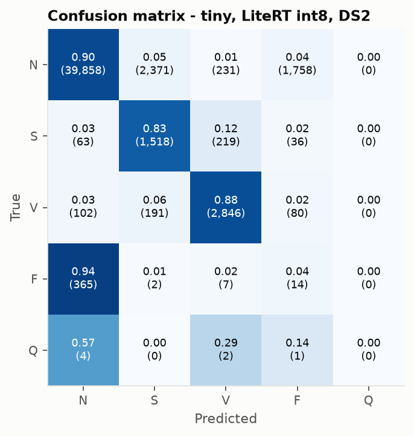
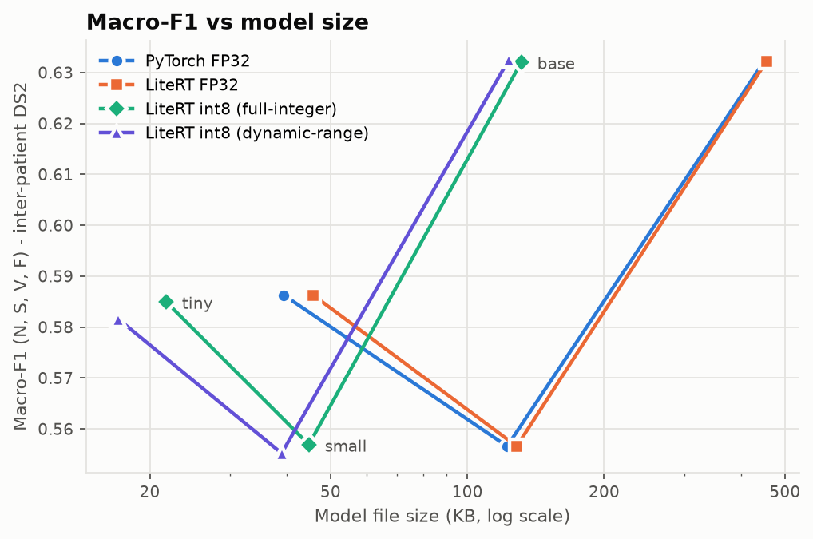
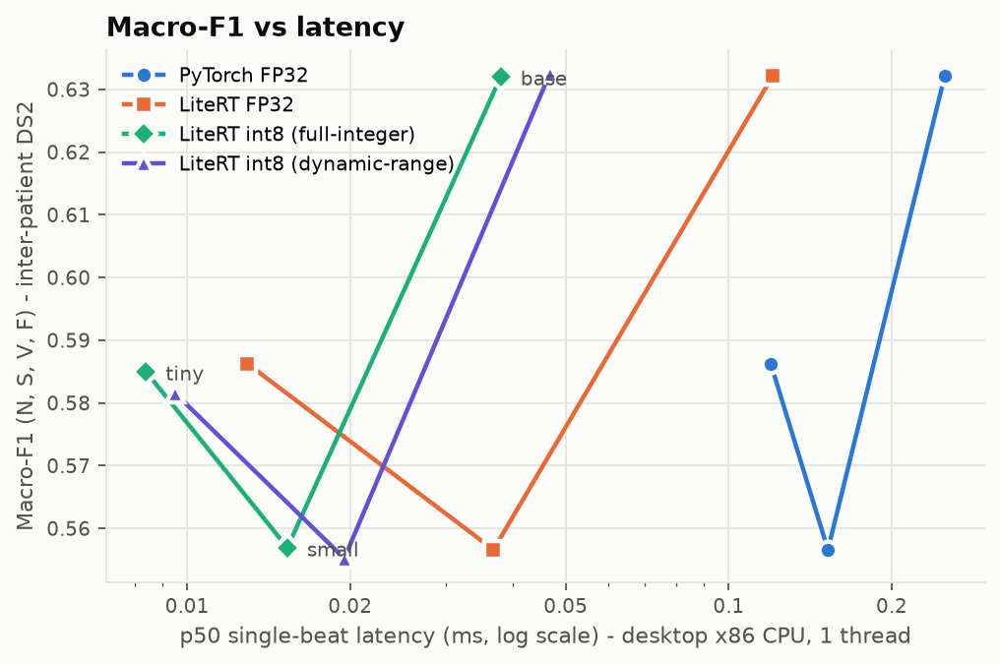
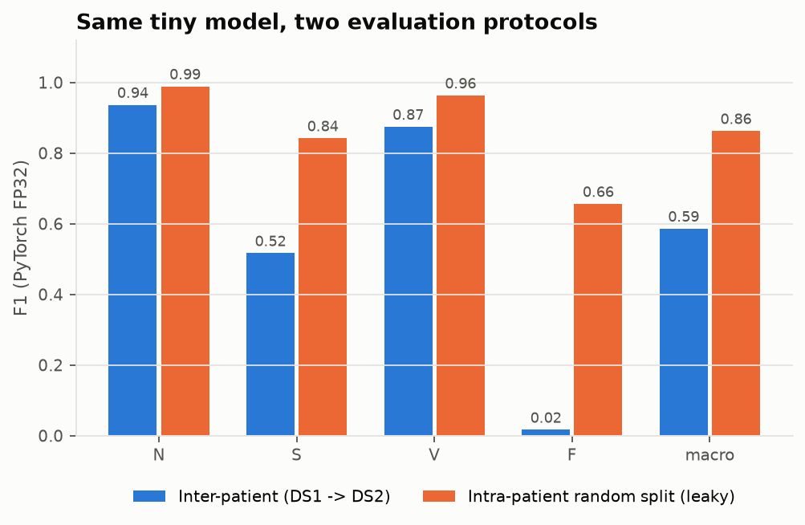

# On-device ECG arrhythmia classification with int8 LiteRT - technical report

_All quantitative content in this report is generated from `results/*.json` by
`scripts/update_docs.py`. Research/education only; not a medical device._

## 1. Problem

Wearable ECG devices must flag abnormal heartbeats locally: streaming raw ECG to the cloud costs
battery, bandwidth and privacy. The task is to classify each heartbeat into the five AAMI EC57
superclasses - **N** (normal and bundle-branch block), **S** (supraventricular ectopic), **V**
(ventricular ectopic), **F** (fusion) and **Q** (unknown) - with a model small and fast enough
for a phone or microcontroller, and to report its accuracy **on patients it has never seen**.

## 2. Data and protocol

The MIT-BIH Arrhythmia Database (48 half-hour two-lead recordings, 360 Hz, beat-level
cardiologist annotations) is downloaded from PhysioNet. We use lead MLII and follow the
inter-patient protocol of de Chazal et al. (2004): records are partitioned into DS1 (training) and
DS2 (testing) so that **no patient contributes to both**. The four paced records are excluded as
AAMI EC57 recommends. Four DS1 records form a patient-wise validation set for early stopping and
model selection; DS2 is used exactly once per model, for the final numbers.

<!-- BEGIN:data_table -->
| Split | Records | Beats | N | S | V | F | Q |
|---|---:|---:|---:|---:|---:|---:|---:|
| train | 18 | 41,257 | 37,232 | 769 | 2,855 | 399 | 2 |
| val | 4 | 9,720 | 8,592 | 174 | 933 | 15 | 6 |
| test | 22 | 49,668 | 44,218 | 1,836 | 3,219 | 388 | 7 |
<!-- END:data_table -->

**Preprocessing.** A 3rd-order zero-phase Butterworth band-pass (0.5-40 Hz) removes baseline
wander and high-frequency noise. Each annotated R-peak gives a 256-sample window (0.25 s before,
~0.46 s after), z-normalised per beat. Eight rhythm features are computed per beat: the previous
and next RR interval, the mean of the previous 10 RR intervals, the mean RR over the previous 5
minutes, and four ratios (pre/local, post/pre, pre/long, post/long). The ratios to the
patient's own long-term rhythm make prematurity, the main cue for S beats, comparable across
patients with different resting heart rates.

## 3. Model and training

`ECGNet` is a four-block 1D-CNN (`Conv1d(k=7) -> BatchNorm -> ReLU -> MaxPool(2)`) followed by global
average pooling. Its output is concatenated with a one-layer MLP embedding of the RR features
(standardised inside the graph with training-set statistics), then a two-layer head produces 5
logits. Three widths span the size/accuracy trade-off: tiny `[8,16,16,32]`, small `[16,32,32,64]`
and base `[32,64,64,128]` channels. The design avoids any op that would block int8 lowering.

Training uses AdamW with a cosine schedule, batch 256, light augmentation (amplitude scaling,
Gaussian noise, small shifts) and **inverse-frequency weighted cross-entropy** (capped at 50x) for
the heavy N-vs-rest imbalance (see the data table above). Early stopping monitors the mean validation F1 over N, S and V
(F has only 15 validation beats, so its F1 is noise). The class-weight exponent was chosen by a
small validation-only sweep (see `docs/DECISIONS.md`, ADR-007). The best width is selected on
validation, not test.

<!-- BEGIN:training_table -->
| Variant | Params | Best epoch | Epochs run | Train time (s, CPU) | Val F1 (N,S,V) | Val macro-F1 (N,S,V,F) |
|---|---:|---:|---:|---:|---:|---:|
| **tiny** | 7,285 | 5 | 13 | 47 | 0.658 | 0.495 |
| small | 28,389 | 13 | 21 | 173 | 0.630 | 0.472 |
| base | 112,069 | 1 | 9 | 202 | 0.611 | 0.458 |
<!-- END:training_table -->

## 4. Conversion and quantisation

Each checkpoint is converted with `litert-torch` (the current name of Google's `ai-edge-torch`):

1. **FP32 LiteRT:** `litert_torch.convert(model, sample_args)`; BatchNorm is folded into the
   convolutions.
2. **Full-integer int8 (static PTQ):** the model is captured with `torch.export`, annotated by
   litert-torch's `PT2EQuantizer` (symmetric, per-channel weights, static activations), calibrated
   with 2,000 beats drawn at random from the **training** split, then converted. The resulting
   flatbuffer has int8 inputs, int8 outputs and int8 activations end to end.
3. **Dynamic-range int8:** same quantiser with `is_dynamic=True` (int8 weights, float activations),
   as an extra comparison row.

All `.tflite` files are evaluated with the LiteRT interpreter (`ai-edge-litert`) on all DS2 beats.
The FP32 conversion is checked to agree with PyTorch on more than 99.9% of predictions.

<!-- BEGIN:quant_findings -->
- **Size:** int8 files are 2.1-3.5x smaller than FP32 .tflite (tiny: 45.8 KB -> 21.7 KB).
- **Accuracy:** macro-F1 change after int8 PTQ ranges -0.0013 to +0.0003 across variants (tiny: -0.0013).
- **Speed (host CPU):** tiny int8 is 1.54x the speed of LiteRT FP32 and 14.2x the speed of eager PyTorch at batch 1.
- **Parity:** FP32 .tflite predictions agree with PyTorch on 100.00% of DS2 beats (minimum over variants; requirement > 99.9%); full-integer int8 agreement is 98.32%-99.12%.
<!-- END:quant_findings -->

<!-- BEGIN:quant_table -->
| Variant | FP32 -> int8 size | Macro-F1 delta | Accuracy delta | Speed-up vs LiteRT FP32 | Speed-up vs PyTorch | FP32 .tflite agreement w/ PyTorch | int8 agreement w/ PyTorch |
|---|---:|---:|---:|---:|---:|---:|---:|
| tiny | 2.11x smaller | -0.0013 | +0.0091 | 1.54x | 14.2x | 100.00% | 98.32% |
| small | 2.87x smaller | +0.0003 | +0.0058 | 2.40x | 10.0x | 100.00% | 98.54% |
| base | 3.47x smaller | -0.0002 | -0.0053 | 3.18x | 6.6x | 100.00% | 99.12% |
<!-- END:quant_table -->

## 5. Results

### 5.1 Best model on unseen patients

<!-- BEGIN:headline_table -->
| Model | Size (KB) | Accuracy | Macro-F1 (N,S,V,F) | F1 N | F1 S | F1 V | F1 F | p50 latency (ms) |
|---|---:|---:|---:|---:|---:|---:|---:|---:|
| tiny - PyTorch FP32 | 39.4 | 0.882 | 0.586 | 0.937 | 0.517 | 0.875 | 0.017 | 0.120 |
| tiny - LiteRT FP32 | 45.8 | 0.882 | 0.586 | 0.937 | 0.517 | 0.875 | 0.017 | 0.013 |
| tiny - LiteRT int8 (full-integer) | 21.7 | 0.891 | 0.585 | 0.942 | 0.513 | 0.872 | 0.012 | 0.008 |
<!-- END:headline_table -->

<!-- BEGIN:per_class_table -->
| Class | Support | Precision (PPV) | Recall (Se) | F1 |
|---|---:|---:|---:|---:|
| N | 44,218 | 0.987 | 0.901 | 0.942 |
| S | 1,836 | 0.372 | 0.827 | 0.513 |
| V | 3,219 | 0.861 | 0.884 | 0.872 |
| F | 388 | 0.007 | 0.036 | 0.012 |
| Q | 7 | 0.000 | 0.000 | 0.000 |
<!-- END:per_class_table -->

### 5.2 Size / accuracy / latency trade-off

<!-- BEGIN:hardware -->
Latency measured on **12th Gen Intel(R) Core(TM) i5-12500H** (x86_64, Linux 6.18.33.2-microsoft-standard-WSL2, WSL2), Python 3.12.15, **1 thread, batch 1**, 100 warm-up + 1000 timed runs. This is **desktop x86 CPU latency, not phone latency** - see [`scripts/android_benchmark.md`](scripts/android_benchmark.md) for on-device measurement.
<!-- END:hardware -->

<!-- BEGIN:results_table -->
| Variant | Runtime | Params | Size (KB) | Accuracy | Macro-F1 | F1 N | F1 S | F1 V | F1 F | p50 (ms) | p95 (ms) | Beats/s |
|---|---|---:|---:|---:|---:|---:|---:|---:|---:|---:|---:|---:|
| **tiny** | PyTorch FP32 | 7,285 | 39.4 | 0.882 | 0.586 | 0.937 | 0.517 | 0.875 | 0.017 | 0.120 | 0.166 | 7,917 |
| **tiny** | LiteRT FP32 | 7,285 | 45.8 | 0.882 | 0.586 | 0.937 | 0.517 | 0.875 | 0.017 | 0.013 | 0.014 | 74,816 |
| **tiny** | LiteRT int8 (full-integer) | 7,285 | 21.7 | 0.891 | 0.585 | 0.942 | 0.513 | 0.872 | 0.012 | 0.008 | 0.009 | 116,881 |
| **tiny** | LiteRT int8 (dynamic-range) | 7,285 | 17.1 | 0.879 | 0.582 | 0.935 | 0.503 | 0.872 | 0.016 | 0.009 | 0.013 | 86,777 |
| small | PyTorch FP32 | 28,389 | 122.3 | 0.793 | 0.557 | 0.879 | 0.447 | 0.887 | 0.012 | 0.152 | 0.210 | 6,284 |
| small | LiteRT FP32 | 28,389 | 128.4 | 0.793 | 0.557 | 0.879 | 0.447 | 0.887 | 0.012 | 0.037 | 0.045 | 26,553 |
| small | LiteRT int8 (full-integer) | 28,389 | 44.8 | 0.798 | 0.557 | 0.883 | 0.444 | 0.891 | 0.010 | 0.015 | 0.020 | 59,944 |
| small | LiteRT int8 (dynamic-range) | 28,389 | 39.0 | 0.792 | 0.555 | 0.879 | 0.442 | 0.888 | 0.012 | 0.020 | 0.021 | 51,102 |
| base | PyTorch FP32 | 112,069 | 450.3 | 0.933 | 0.632 | 0.969 | 0.642 | 0.874 | 0.044 | 0.251 | 0.312 | 3,851 |
| base | LiteRT FP32 | 112,069 | 455.7 | 0.933 | 0.632 | 0.969 | 0.642 | 0.874 | 0.044 | 0.121 | 0.143 | 8,038 |
| base | LiteRT int8 (full-integer) | 112,069 | 131.4 | 0.928 | 0.632 | 0.966 | 0.647 | 0.873 | 0.043 | 0.038 | 0.049 | 24,886 |
| base | LiteRT int8 (dynamic-range) | 112,069 | 123.4 | 0.932 | 0.633 | 0.968 | 0.644 | 0.875 | 0.044 | 0.047 | 0.058 | 21,218 |
<!-- END:results_table -->

### 5.3 Inter- vs intra-patient

<!-- BEGIN:protocol_table -->
| Protocol (same architecture, PyTorch FP32) | Test beats | Accuracy | Macro-F1 (N,S,V,F) | F1 N | F1 S | F1 V | F1 F |
|---|---:|---:|---:|---:|---:|---:|---:|
| **Inter-patient** (DS1 -> DS2, unseen patients) | 49,668 | 0.882 | 0.586 | 0.937 | 0.517 | 0.875 | 0.017 |
| Intra-patient random 80/20 split (leaky, optimistic) | 20,129 | 0.979 | 0.863 | 0.989 | 0.842 | 0.963 | 0.656 |
<!-- END:protocol_table -->

<!-- BEGIN:protocol_text -->
The identical architecture scores macro-F1 **0.863** on a random beat-level split but **0.586** on unseen patients - a gap of 0.276. The random split lets the network memorise each patient's beat morphology, because neighbouring beats of the same person sit in both train and test.
<!-- END:protocol_text -->

## 6. Discussion

- **Post-training int8 is close to free for this model.** Across all three widths the
  full-integer int8 model's macro-F1 stays within a few thousandths of its FP32 parent
  (Section 4), while the file shrinks several-fold and single-beat latency drops. The network is
  shallow, uses ReLU, and its BatchNorm-folded activations are well bounded, which suits per-channel
  static PTQ. Quantisation-aware training would only be worth it for much narrower models. One
  engineering detail mattered: the RR-feature standardisation was first exported as float `SUB`/`MUL`
  ops in front of an int8 graph. Folding it into the first `Linear` layer (an exact algebraic
  rewrite, unit-tested) made the model integer-only from input to output.
- **Size reduction depends on model size.** The tiny model's flatbuffer is dominated by fixed
  overhead (graph structure, quantisation parameters), so int8 saves less there than on the base
  model, where weights dominate.
- **Model selection, not capacity, is the bottleneck.** On DS2 the trade-off is non-monotonic
  (small is the weakest width) and the base model scores the highest macro-F1. Yet the
  validation records ranked tiny first, and base early-stopped at its first epoch. With four
  validation patients, run-to-run variance is comparable to the capacity effect. The headline
  model was still chosen on validation, because re-selecting on test would invalidate the
  number (ADR-016). Patient-wise k-fold selection over DS1 is the obvious fix.
- **S beats: high recall, low precision.** The model finds most supraventricular beats in unseen
  patients, but it also flags a meaningful number of normal beats as S (confusion matrix). Its
  prematurity features fire on irregular normal rhythm. It also misses S beats inside
  sustained supraventricular runs (visible in the live demo), where every interval is short and
  the ratio features no longer signal prematurity.
- **F beats do not generalise.** Nearly all DS1 fusion beats come from one patient (record 208),
  so the model has effectively seen fusion in one person; DS2 F-F1 is near zero for every width,
  as for many published inter-patient models.
- **Latency.** On a desktop CPU a single-beat int8 inference costs microseconds to tens of
  microseconds. At about one beat per second, compute is negligible next to sensing and radio
  power, which is the case for on-device ECG analysis. Phone measurements are left to
  `scripts/android_benchmark.md`.

## 7. Limitations

Reference R-peak annotations are used instead of a detector; the band-pass filter is zero-phase
(offline); post-RR adds one beat of delay; only one lead and one database are used; validation
validation records are few and hard, so model selection is noisy (ADR-016); latency is not measured on a phone.

## 8. Reproducibility

`make all` rebuilds everything from the raw PhysioNet download on Linux/macOS (pinned
`requirements.txt`, seeded runs, CPU only). Models are attached to the v1.0.0 GitHub release.

## References

1. Moody GB, Mark RG. The impact of the MIT-BIH Arrhythmia Database. *IEEE Eng Med Biol Mag* 20(3):45-50, 2001.
2. Goldberger AL et al. PhysioBank, PhysioToolkit, and PhysioNet. *Circulation* 101(23):e215-e220, 2000.
3. de Chazal P, O'Dwyer M, Reilly RB. Automatic classification of heartbeats using ECG morphology and heartbeat interval features. *IEEE TBME* 51(7):1196-1206, 2004.
4. ANSI/AAMI EC57:2012. Testing and reporting performance results of cardiac rhythm and ST segment measurement algorithms.
